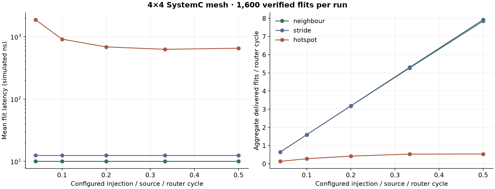
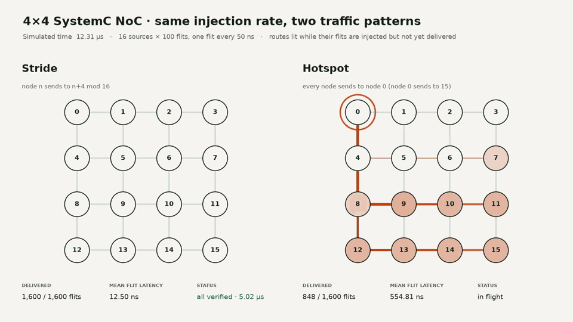
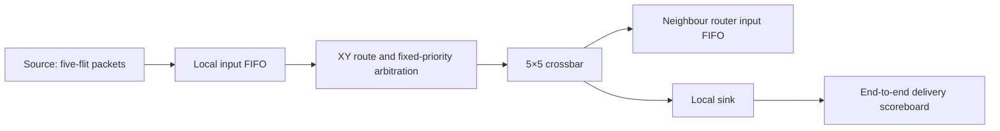

# 4×4 Network-on-Chip Simulator

A **SystemC simulation model** of a 16-node mesh with five-port routers, XY routing,
four-flit input FIFOs, fixed-priority arbitration and output reservations held until
a packet's tail flit. Started in COE838 (System-on-Chip Design, winter 2025);
refreshed with automated verification and traffic experiments in October 2026.

This is architecture modeling, not synthesized RTL or a physical FPGA implementation.



## Demo

[](docs/assets/traffic-demo.mp4)

[Watch the 22-second replay (MP4)](docs/assets/traffic-demo.mp4). Two runs at the
same injection rate (16 sources × 100 flits, one every 50 ns), replayed from their
VCD traces: stride traffic delivers every flit in 5.02 µs at 12.5 ns mean latency,
while hotspot traffic to node 0 takes 28.84 µs at 911.25 ns. The trace records
injection and delivery, not per-hop positions, so a route is lit while its flits
are in flight. Regenerate with [`scripts/replay.py`](scripts/replay.py).

## What I built

The course supplied a 1×2 router/FIFO/crossbar baseline. My submitted work expanded
it to a 4×4 mesh, connected all 16 nodes, added coordinate routing, configurable
destinations, traffic patterns and timestamp logging. The low-level router pipeline
is derived from that supplied infrastructure.

The 2026 refresh adds a portable CMake dependency, a noninteractive CLI, bounded
injection and drain, full-flit delivery checks, packet/flit metrics and a load sweep.
It also recomputes arbitration availability each cycle and checks FIFO bounds.
[Provenance and limitations](docs/provenance.md) distinguish this work from the baseline.

## Run

Requires CMake 3.16+, a C++17 compiler, Python 3 and SystemC 3.0.0 built with C++17.
Install SystemC using [Accellera's CMake instructions](https://github.com/accellera-official/systemc/blob/3.0.0/cmake/INSTALL_USING_CMAKE.md).

```sh
cmake -S . -B build -DCMAKE_PREFIX_PATH=/path/to/systemc-install
cmake --build build -j2
ctest --test-dir build --output-on-failure
cd build
./noc neighbour 125 10
```

CLI: `noc [neighbour|stride|hotspot] [source-period-ns] [flits-per-source]`.
The period is 10–1,000,000 ns; the count is 5–1,000 and must be divisible by five.
Each run writes `NoC_trace.vcd` in its working directory and a JSON summary. Any
wrong destination, payload, flit order, duplication, missing flit or incomplete
packet makes the run fail. The router and sink clock periods are both 5 ns.

## Architecture



Node IDs are `4*y + x`. XY routing first resolves the column, then the row.
Each router has local, north, east, south and west ports. An input retains an
output reservation across all five flits; a tail releases it. Backpressure pauses
injection when the local input FIFO is full. The model is event-driven and uses
packet signal changes plus clocked grants, rather than a ready/valid RTL link.

## Verification and measurements

`ctest` runs **15 scenarios**: three patterns × five injection periods. Each checks
**1,600 flits / 320 completed packets**, including full source-to-sink data and order.
The finite workloads all drain successfully. An invalid partial-packet count is
also rejected. [Retained check output](docs/evidence/verification-2026-10-04.log).

| Pattern | Destination | At 125 ns injection | At 10 ns injection |
| --- | --- | --- | --- |
| Neighbour | Adjacent row pair | 10 ns mean flit latency | 10 ns |
| Stride | `(source + 4) % 16` | 12.5 ns | 12.5 ns |
| Hotspot | All sources → 0; 0 → 15 | 1,866.166 ns | 652.106 ns |

The archived report called stride “uniform”; it is a deterministic permutation,
not random uniform traffic. Its “160 packets” case consists of **160 flits / 32
packets**. The refreshed two-packet-per-source neighbour run reproduces 10 ns
mean flit latency. Packet latency measures first-flit injection to tail reception,
so the same 125 ns-period run has 510 ns mean packet latency.

The hotspot experiment shows an effect of this particular arbitration design:
slow sources hold an output reservation while the rest of a packet is generated,
delaying competing flows. Higher configured injection therefore need not raise
mean latency monotonically. This is a finite, backpressured experiment; it does
not establish a steady-state saturation limit or starvation freedom. Throughput
is aggregate received flits divided by the window from time zero to final delivery,
including initial fill and drain. It is not a hardware bandwidth measurement.

[Raw CSV](docs/evidence/traffic-sweep.csv) · [Metric definitions](docs/verification.md)

```sh
python3 scripts/sweep.py
# Optional plot dependency: matplotlib
python3 scripts/plot.py
```

GitHub Actions builds SystemC 3.0.0, runs the same checks and uploads the sweep.
VCD inspection is optional; automated correctness does not depend on a waveform viewer.

## Scope

No torus topology, random-uniform generator, virtual channels, adaptive routing,
RTL synthesis or board execution is claimed. Fixed-priority arbitration can be
unfair; the tests cover the listed finite workloads, not arbitrary traffic.
Preserved coursework is in `archive/`; refreshed source is in `src/`.
